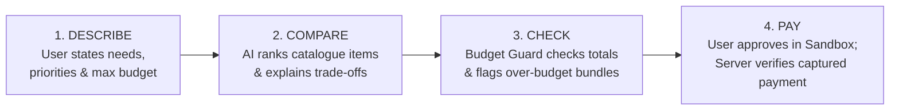

# PayPilot AI 2.0 — Budget-Aware AI Shopping Assistant
### PayPal AI Hackathon 2026 • Final Integrated Project

[](LICENSE)
[](tests/)
[](tests/run_tests.ps1)
[](app/services/paypal_service.py)
[](#-hackathon-accuracy-and-safety-checklist-compliance)

---

## 📌 Executive Summary & Product Promise

**PayPilot AI 2.0** connects conversational AI shopping discovery with **deterministic budget guardrails** and **server-side verified PayPal Sandbox checkout**.

When shoppers face multi-item purchases with strict financial constraints (e.g. moving into an unfurnished dorm or replacing a broken laptop urgently), standard AI chatbots frequently hallucinate calculations, hide budget shortfalls, or fail to safely bridge into checkout.

**The Product Promise**:
- **AI interprets requests and explains trade-offs**: Understands complex constraints, ranks controlled catalogue options, and explains qualitative compromises.
- **Deterministic calculations use known catalogue prices**: Independent **Budget Guard** calculates arithmetic, taxes, shipping, 7-day bill obligations, and surplus buffers without hallucination.
- **Genuine PayPal Sandbox checkout**: Prepared orders lock server-side prices before directing buyers to PayPal Sandbox. Server strictly captures and verifies that amount and currency match before confirming payment.
- **Honest capability claims**: Never claim access to unauthorized live bank balances or unverified PayPal features.

---

## 🧭 Core 4-Step User Journey



1. **Describe**: User submits natural-language intent (e.g., *"College student moving into an unfurnished dorm with a strict $150 total budget"*).
2. **Compare**: AI compares items from a controlled catalogue across price, reliability scores, and specifications, detailing compromises side-by-side.
3. **Check**: **Budget Guard** deterministically totals exact catalogue prices, incorporates bills due within 7 days, alerts on deficits, and offers 1-click substitutions.
4. **Pay**: Locks order on server, initiates PayPal Sandbox Orders v2 flow, records buyer approval, and confirms purchase only after server-side capture verification.

---

## 👥 Three-Member Team Work Division (Changes in Bold)

All three teammates collaborated in this single, unified repository with explicitly defined module ownership:

| Member | Previous / Base Role | Updated Responsibilities | Hackathon Change & Deliverable |
| :--- | :--- | :--- | :--- |
| **Suryansh** *(You)* | Frontend/dashboard, accessibility & PayPal integration | Frontend/dashboard, product cards, comparison, accessibility controls (WCAG AAA high contrast, scalable typography, TTS, ARIA announcer), and checkout screens; connects UI to backend APIs and renders multi-item bundle totals. PayPal Sandbox Orders v2 create → buyer approval → capture → server-side verification; anti-tampering guards, error/cancellation handling, Pay in 4 compliance calculator, and end-to-end integration coordination. | **Clear ownership of the full shopping UI, bundle comparison, payment verification, and integration coordination.** |
| **Jaskaran** | Flask backend/database, Budget Guard & AI chatbot | Flask backend, SQLite schema/seeding, catalogue, trusted product prices, product/bill APIs, and Budget Guard calculations; AI intent parsing, product ranking, recommendations and trade-off explanations; handles multi-constraint prompts and trade-offs across several items; voice input; zero-spam financial filter. | **Backend priority on catalogue + Budget Guard, and multi-item AI reasoning is core.** |
| **Akashdeep** | Product data, comparison/charts, testing | Product/sample price data and history labels; tests bundle, emergency-expense, and checkout scenarios; owns master README, open-source licence, setup notes, and demo readiness. | **Testing, documentation/licensing, and demo readiness are explicit deliverables.** |

Detailed individual module documentation:
- 📖 [Suryansh's Frontend & Accessibility Documentation](docs/MODULE_SURYANSH_FRONTEND.md)
- 📖 [Suryansh's PayPal Integration & Security Documentation](docs/MODULE_SURYANSH.md)
- 📖 [Jaskaran's Backend & Budget Guard Documentation](docs/MODULE_JASKARAN.md)
- 📖 [Jaskaran's AI Reasoning Engine Documentation](docs/MODULE_JASKARAN_AI.md)
- 📖 [Akashdeep's Data, Testing & QA Documentation](docs/MODULE_AKASHDEEP.md)

---

## 🚀 Key Features (10 Complete Capabilities)

### 🌟 Three 2.0 Additions
- **10 • Multi-Item Budget Optimizer (Core MVP)**: Evaluates Cartesian product combinations across requested categories against one budget ceiling. Solves multi-constraint trade-offs (e.g. Lamp + Steamer + ANC Earbuds $\le$ $150).
- **08 • Emergency Expense & Medical Bill Navigator**: Urgent replacement assistant (e.g., broken work laptop under $500). Prioritizes 1-day delivery turnaround and warranty terms over minor price differences.
- **09 • Autonomous Group Travel & Event Co-Pilot**: Group event budget estimation and per-person cost allocation architecture.

### 🛡️ Seven Retained Capabilities
- **01 • Adaptive Universal Accessibility**: WCAG AAA High Contrast Theme, Font Scaler (100% / 120% / 140%), Full Keyboard Focus Navigation (`Alt+K`, `Alt+H`, `Alt+T`, `Alt+R`), and Web Speech Text-to-Speech synthesis.
- **02 • Hands-Free Voice Commands**: Natural language voice search with mandatory affirmative user confirmation modal before any checkout action (`requires_explicit_confirmation: true`).
- **03 • Proactive Financial Health Monitoring**: Tracks user-recorded bills due within 7 days ($80.00) and displays safe disposable shopping budget ($70.00). Transparently disclaims zero unauthorized bank access.
- **04 • Secure Biometric & Passwordless Payments**: Passkey readiness architecture without confusing login with transactional authorization.
- **05 • AI Budget-Conscious Shopping Chatbot**: Multi-turn preference exploration, trade-off explanations, and dynamic basket re-optimization when budgets change.
- **06 • PayPal Honey Price Trend & History Engine**: 90-day price trend visualizer with transparent simulated dataset disclosures.
- **07 • Zero-Spam Financial Smart Filter**: Classifies incoming messages (`IMPORTANT`, `PROMOTIONAL`, `SUSPICIOUS`) and highlights warning signs without silently deleting communications.

---

## 🌟 The Jaw-Dropping Demo Scenario

### Prompt
> *"I’m a college student moving into an unfurnished dorm with a strict $150 total budget. I need a desk lamp, a portable steamer, and noise-cancelling study buds. Prioritize reliability and explain compromises."*

### Result Walkthrough
1. **AI Natural Language Parsing**:
   - Categories: `desk_lamp`, `portable_steamer`, `noise_cancelling_earbuds`
   - Budget: `$150.00 (Strict)`
   - Priority: `Reliability` | Context: `College Dorm`
2. **Multi-Item Optimization (36 combinations evaluated)**:
   - **TaoTronics Multi-Spectrum Desk Lamp**: $32.99 | ★ 9.2/10
   - **Conair Turbo ExtremeSteam Handheld Steamer**: $44.99 | ★ 9.4/10
   - **Anker Soundcore Space A40 Adaptive ANC Earbuds**: $59.99 | ★ 9.4/10
3. **Deterministic Budget Guard Arithmetic**:
   $$\$32.99 + \$44.99 + \$59.99 = \$137.97 \quad (\text{Surplus Buffer: } +\$12.03)$$
   Status: **`UNDER BUDGET`** | Average Reliability: **`9.33 / 10`**
4. **AI Trade-Off Explanation**:
   - Chose TaoTronics ($32.99) over BenQ ($89.00) saving $56.01, allowing room for premium ANC earbuds while preserving 9.2/10 reliability.
   - If BenQ is selected, total reaches **$193.98 ($43.98 OVER BUDGET)**; Budget Guard instantly displays 1-click swap alternatives.
5. **PayPal Sandbox Checkout**:
   - Order locked on server (`POST /api/orders/prepare`)
   - Sandbox Orders v2 created (`POST /api/orders/<id>/create-paypal-order`)
   - Buyer approval recorded (`POST /api/orders/<id>/simulate-approval` or PayPal return redirect)
   - Server-side capture & mathematical verification (`POST /api/orders/<id>/capture`) confirms funds before receipt is issued.

---

## 🛡️ Hackathon Accuracy and Safety Checklist Compliance

| Checklist Rule | Implementation & File Enforcement |
| :--- | :--- |
| **Do not claim PayPal Pay in 4 is always available** | Explicit disclaimers on every calculation: *"Subject to consumer eligibility and credit checks by PayPal at checkout. It is not guaranteed."* (`app/services/paypal_service.py:375`, `frontend/js/paypal_checkout_ui.js:210`) |
| **Do not treat a small installment as proof of affordability** | Clear warning alongside schedule: *"Paying in 4 installments of $34.49 does not reduce your total financial obligation. The full cost remains $137.97."* (`app/services/paypal_service.py:368`) |
| **Do not claim payment succeeded until backend verifies captured order** | Order creation (`CREATED`) or approval page opening (`APPROVED`) is strictly **rejected** as proof of payment. Payment status is only set to `CAPTURED` after server validates amount, currency, and PayPal capture response (`app/services/order_service.py:440-490`). |
| **Do not present simulated price history as live** | Price history carries mandatory badge: `Simulated Historical Dataset (Inspired by PayPal Honey). Not an active Honey API feed.` (`data/price_history.json`, `frontend/js/catalogue_data.js`). |
| **Do not claim unauthorized bank balance access** | 7-day bill monitor explicitly states: *"Calculated from user-recorded bills. Live bank balance connections are not accessed."* (`frontend/js/bill_manager_ui.js:52`). |
| **Do not silently delete messages or claim definitive fraud detection** | Smart filter classifies with clear heuristics, never deletes messages, and notes assessments are warning guidance (`app/services/financial_smart_filter.py:120`). |
| **Do not put PayPal credentials in a public repo** | Secrets are isolated in `.env` and `.env.example`, loaded server-side only (`.gitignore`, `app/config.py`). |

---

## 📁 Repository Structure

```text
E:\PayPilot_AI_Final\
├── run.py                             # Unified Flask server launcher (Port 5001)
├── start_demo.ps1                     # 1-Click PowerShell Demo launcher (Tests + Browser)
├── start_demo.bat                     # 1-Click Windows batch demo launcher
├── demo_jaskaran_ai.py                # Standalone AI reasoning & chatbot demo script
├── demo_suryansh_integration.py       # Standalone PayPal Sandbox & security demo script
├── requirements.txt                   # Production dependencies
├── LICENSE                            # MIT Open-Source License
├── README.md                          # Master Hackathon Documentation (You are here)
├── .env.example                       # Environment template with PayPal & Gemini keys
│
├── app/                               # Integrated Python / Flask Application
│   ├── __init__.py                    # App factory, blueprints, CORS & static serving
│   ├── config.py                      # Environment configuration
│   ├── database.py                    # SQLite connection pool & table creation
│   ├── models.py                      # Data model representations
│   ├── data/
│   │   ├── schema.sql                 # SQL schema (products, bills, locked_orders)
│   │   └── seed_data.py               # Seed data populator with retail benchmarks
│   ├── routes/
│   │   ├── health_routes.py           # Health checks & frontend asset serving
│   │   ├── catalogue_routes.py        # /api/products, /api/categories
│   │   ├── budget_guard_routes.py     # /api/budget-guard/check, optimize, alternatives
│   │   ├── bill_routes.py             # /api/bills, /api/bills/summary
│   │   ├── order_routes.py            # /api/orders (prepare, create, capture, pay-in-4)
│   │   └── ai_routes.py               # /api/ai (parse-intent, recommend, chat, voice, filter)
│   └── services/
│       ├── ai_intent_parser.py        # Natural language multi-constraint parsing
│       ├── ai_ranking_engine.py       # Cartesian product multi-factor ranking
│       ├── ai_tradeoff_explainer.py   # Deterministic trade-off rationale generation
│       ├── ai_conversational_assistant.py # Stateful multi-turn shopping chatbot
│       ├── budget_guard.py            # Zero-hallucination arithmetic & substitutions
│       ├── catalogue_service.py       # Product filtering, search, and price history
│       ├── bill_service.py            # 7-day bill obligations & disposable income
│       ├── order_service.py           # Server-side order locking & capture verification
│       ├── paypal_service.py          # PayPal Orders v2 Sandbox client & Pay in 4
│       ├── voice_command_service.py   # Speech intent parser with payment confirmation guardrail
│       ├── financial_smart_filter.py  # Phishing & notification classification
│       └── gemini_service.py          # Optional Google Gemini LLM provider fallback
│
├── frontend/                          # Suryansh's Complete Web Shopping Interface
│   ├── index.html                     # Responsive 4-step shopping application
│   ├── serve.ps1                      # Standalone frontend HTTP server
│   ├── css/
│   │   ├── styles.css                 # PayPal design system, product cards, matrices
│   │   └── accessibility.css          # High contrast mode & scalable typography
│   ├── js/
│   │   ├── config.js                  # Frontend configuration & API base URL
│   │   ├── catalogue_data.js          # Verified retail catalogue data
│   │   ├── api.js                     # REST API client with local deterministic fallback
│   │   ├── accessibility.js           # Contrast toggle, font scaler, Web Speech TTS
│   │   ├── voice.js                   # Web Speech Recognition & confirmation modal
│   │   ├── bill_manager_ui.js         # 7-day bill tracker & disposable budget callout
│   │   ├── budget_guard_ui.js         # Comparison matrix & over-budget 1-click swaps
│   │   ├── paypal_checkout_ui.js      # 4-stage PayPal Sandbox checkout modal
│   │   └── app.js                     # UI controller & scenario event handlers
│   └── tests/
│       ├── run_tests.html             # Browser-based automated test runner
│       └── test_suryansh_work.js      # 10 comprehensive frontend test suites
│
├── data/                              # Verified JSON Datasets (Owned by Akashdeep)
│   ├── products.json                  # Controlled catalogue items with provenance
│   ├── price_history.json             # 90-day price movements (simulated Honey trends)
│   ├── sample_bills.json              # Upcoming bills due within 7 days
│   ├── comparison_matrix.json         # Evaluation benchmarks & trade-offs
│   └── demo_scenarios.json            # Hackathon scenarios & PayPal fixtures
│
├── utils/                             # Shared Data Loading & Math Utilities (Owned by Akashdeep)
│   ├── data_loader.py                 # JSON ingestion with provenance verification
│   ├── budget_guard.py                # Standalone deterministic arithmetic
│   └── comparison_helper.py           # Side-by-side matrices & compromise summaries
│
├── docs/                              # Comprehensive Hackathon Materials
│   ├── DEMO.md                        # Presentation & 3-minute pitch script
│   ├── SETUP.md                       # Environment setup & developer guide
│   ├── MODULE_SURYANSH_FRONTEND.md    # Frontend & accessibility details
│   ├── MODULE_JASKARAN.md             # Backend & Budget Guard details
│   ├── MODULE_JASKARAN_AI.md          # AI reasoning & chatbot details
│   ├── MODULE_SURYANSH.md             # PayPal Sandbox & security details
│   └── MODULE_AKASHDEEP.md            # Data & testing details
│
└── tests/                             # Automated Test Suites (84 Tests Passing)
    ├── conftest.py                    # Pytest test fixtures (isolated SQLite app)
    ├── run_tests.ps1                  # Native Windows PowerShell test runner (8 tests)
    ├── akashdeep/                     # Scenario & data integrity tests
    │   ├── test_bundle_scenarios.py
    │   ├── test_checkout_scenarios.py
    │   ├── test_data_integrity.py
    │   └── test_emergency_expense_scenarios.py
    ├── jaskaran/                      # AI reasoning, chatbot, voice, bills, & API tests
    │   ├── test_ai_api_routes.py
    │   ├── test_ai_conversational_assistant.py
    │   ├── test_ai_intent_parser.py
    │   ├── test_ai_ranking_engine.py
    │   ├── test_ai_tradeoff_explainer.py
    │   ├── test_api_routes.py
    │   ├── test_bills.py
    │   ├── test_budget_guard.py
    │   ├── test_catalogue.py
    │   ├── test_emergency_navigator.py
    │   ├── test_financial_smart_filter.py
    │   └── test_voice_commands.py
    └── suryansh/                      # PayPal Sandbox integration & security tests
        └── test_paypal_integration.py
```

---

## 🚦 How to Run & Verify

### 1. One-Click Demo Launcher (PowerShell / Windows)
Runs automated scenario tests, verifies guardrails, and opens the interactive web demo in your default browser:
```powershell
.\start_demo.ps1
```
*(Or double-click `start_demo.bat` in Windows Explorer)*

---

### 2. Run the Full Backend Server
```bash
python run.py
```
- Listens on **`http://127.0.0.1:5001`**.
- Automatically initializes `paypilot.db` and seeds product catalogue and bill fixtures.
- Open **`http://127.0.0.1:5001/`** in your browser to interact with the full web app!

---

### 3. Run Automated Tests

#### Option A: Full Pytest Suite (84 Tests Passing)
```bash
python -m pytest -v
```
Validates:
- 17 Akashdeep scenario, integrity, and checkout tests
- 58 Jaskaran AI intent, ranking, chatbot, voice, and API tests
- 9 Suryansh PayPal Sandbox checkout, anti-tampering, and Pay in 4 tests

#### Option B: Zero-Dependency Native PowerShell Suite (8 Tests Passing)
```powershell
powershell -ExecutionPolicy Bypass -File .\tests\run_tests.ps1
```

#### Option C: Suryansh's Interactive Frontend Test Suite (10 Suites Passing)
Open `frontend/tests/run_tests.html` in any browser or start `frontend/serve.ps1`.

---

### 4. Run Standalone Terminal Demonstrations

#### Jaskaran's AI Reasoning Walkthrough:
```bash
python demo_jaskaran_ai.py
```
Prints multi-turn dialogue, trade-offs, voice safety guardrails, and phishing classification directly to console.

#### Suryansh's PayPal Sandbox Integration Walkthrough:
```bash
python demo_suryansh_integration.py
```
Walks through order locking, PayPal Orders v2 creation, simulated buyer approval, server-side capture verification, and tampering rejection.

---

## 📡 REST API Reference

### 1. Catalogue & Products
| Endpoint | Method | Description |
| :--- | :--- | :--- |
| `/api/products` | `GET` | List products with category, price range, search, and sorting. |
| `/api/products/<id>` | `GET` | Single product details with verified retail benchmark data. |
| `/api/products/<id>/price-history` | `GET` | 90-day price movement trend with simulated Honey disclosure. |
| `/api/categories` | `GET` | Available categories with item counts and price boundaries. |

### 2. Budget Guard Engine
| Endpoint | Method | Description |
| :--- | :--- | :--- |
| `/api/budget-guard/check` | `POST` | Deterministic bundle total, surplus/deficit calculation, and 7-day bill awareness. |
| `/api/budget-guard/optimize-bundle` | `POST` | Multi-category optimization maximizing reliability under a stated budget. |
| `/api/budget-guard/alternatives` | `POST` | 1-click viable substitutions when a selected basket exceeds budget. |

### 3. PayPal Sandbox Checkout (Suryansh)
| Endpoint | Method | Description |
| :--- | :--- | :--- |
| `/api/orders/prepare` | `POST` | Locks items and catalogue prices on server, preventing client-side price tampering. |
| `/api/orders/<id>/create-paypal-order` | `POST` | Creates PayPal Orders v2 record in Sandbox; returns `approval_url`. |
| `/api/orders/<id>/simulate-approval` | `POST` | Records buyer checkout approval (never treated as payment proof). |
| `/api/orders/<id>/capture` | `POST` | Server-side capture & mathematical verification against locked catalogue total. |
| `/api/orders/<id>/cancel` | `POST` | Handles buyer cancellation and records state. |
| `/api/orders/<id>/pay-in-4` | `GET` | Pay in 4 installment breakdown with required safety and credit disclosures. |
| `/api/orders/verify-capture` | `POST` | Server capture verification against client-submitted details. |

### 4. AI Shopping Assistant (Jaskaran)
| Endpoint | Method | Description |
| :--- | :--- | :--- |
| `/api/ai/parse-intent` | `POST` | Parses natural language prompts into categories, budget, and priority. |
| `/api/ai/recommend-bundle` | `POST` | Generates recommended, budget-saver, and premium bundles with trade-off rationale. |
| `/api/ai/chat` | `POST` | Multi-turn conversational assistant with context preservation and dynamic re-optimization. |
| `/api/ai/voice-command` | `POST` | Processes voice transcripts; strictly enforces confirmation on checkout. |
| `/api/ai/smart-filter` | `POST` | Classifies communications into `IMPORTANT`, `PROMOTIONAL`, or `SUSPICIOUS` with red-flag analysis. |

### 5. Proactive Financial Health
| Endpoint | Method | Description |
| :--- | :--- | :--- |
| `/api/bills` | `GET`, `POST` | Retrieve and record user bills. |
| `/api/bills/<id>` | `PUT`, `DELETE` | Update or remove bill records. |
| `/api/bills/summary` | `GET` | Calculates bills due within 7 days and safe disposable shopping balance. |

---

## 📄 License

This project is licensed under the **MIT License** — see the [LICENSE](LICENSE) file for details.
All product brands and benchmarks referenced are for demonstration and hackathon evaluation purposes.
