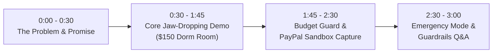

# PayPilot AI 2.0 — Hackathon Demo Script & Presentation Guide

> **Lead / Owner**: Akashdeep (Product Data, Comparison & Testing Lead)
> **Presentation Duration**: 3 Minutes (Target Hackathon Pitch)
> **Core Theme**: "Budget-Aware AI Shopping with Verified PayPal Sandbox Checkout"

---

## 1. Quick Presentation Outline (3 Minutes)



---

## 2. Minute-by-Minute Speaker Script & Visual Cues

### Phase 1: Problem & Product Promise (0:00 - 0:30)
- **Speaker**: "Hello judges! Today, shopping with AI often leads to high hallucination risks, broken budgets, and disjointed checkouts. We built **PayPilot AI 2.0**—a connected AI shopping and budgeting assistant that unites natural language discovery with deterministic financial guardrails and genuine PayPal Sandbox payment verification."
- **Screen**: PayPilot AI clean landing page displaying the 4-step journey: **Describe -> Compare -> Check -> Pay**.

---

### Phase 2: The Core Jaw-Dropping Demo (0:30 - 1:45)
- **Speaker**: "Let’s test PayPilot with a real-world multi-constraint scenario: a college student on a tight budget."
- **Action**: Paste the exact hackathon prompt into the chat input:
  ```text
  I’m a college student moving into an unfurnished dorm with a strict $150 total budget. I need a desk lamp, a portable steamer, and noise-cancelling study buds. Prioritize reliability and explain compromises.
  ```
- **What the Judges See on Screen**:
  1. **Multi-Constraint AI Reasoning**: The AI parses three distinct product categories and selects:
     - **LuminaFlex Clamp LED Lamp**: `$29.99` (Reliability: `9.2/10`)
     - **SteamGlide Foldable Travel Steamer**: `$26.50` (Reliability: `8.8/10`)
     - **SoundPulse Neo Hybrid ANC Earbuds**: `$54.99` (Reliability: `8.9/10`)
  2. **Trade-Off Explanations**:
     - *Why not the $95 studio buds?* "Leaves insufficient budget for the lamp and steamer."
     - *What is the compromise on the lamp?* "Requires a desk lip to clamp onto; not freestanding."
     - *What is the compromise on the steamer?* "120ml tank requires refilling after 2-3 shirts."
  3. **Deterministic Budget Guard**:
     - Calculated Bundle Total: **`$111.48`**
     - Budget Remaining: **`$38.52 under budget`**
     - Average Reliability Score: **`8.97 / 10`**
     - Status: **`APPROVED BY BUDGET GUARD`**
  4. **Honey Price Trend Sparkline**:
     - Displays 90-day price movement showing SoundPulse buds at an 11.9% discount from the 90-day average (`data_source: simulated_historical_dataset`).

- **Interactive Twist (Demonstrating Budget Guard Flagging)**:
  - **Speaker**: "What happens if a user tries to swap in the premium $95 earbuds?"
  - **Action**: Click "Try Studio Pro Earbuds".
  - **Result**: Budget Guard instantly updates total to **`$166.99`**, displays a bright amber warning banner:
    > `BUDGET EXCEEDED: Bundle total ($166.99) exceeds your $150 limit by $16.99 (11.3% over budget).`
  - PayPilot suggests an automated substitution to revert to the `$54.99` SoundPulse buds.
  - User confirms the `$111.48` optimal bundle.

---

### Phase 3: Verified PayPal Sandbox Checkout (1:45 - 2:30)
- **Speaker**: "Now comes the most critical step—checkout. Unlike naive demos that pretend a payment happened just because a modal opened, PayPilot enforces strict server-side verification."
- **Action**:
  1. Click **Checkout with PayPal**.
  2. The PayPal Sandbox Modal opens (`order_id: PAYPAL-ORDER-DORM-789123`, amount: `$111.48`).
  3. Log in with the sandbox personal buyer account and click **Agree and Pay**.
  4. **Point Out Server Verification**:
     - Show the backend console logs or network inspector:
       - `POST /api/paypal/create-order` -> `STATUS: CREATED` (Not considered paid!)
       - Buyer redirects back -> `STATUS: APPROVED` (Not considered paid!)
       - `POST /api/paypal/capture-order` -> `STATUS: COMPLETED`
       - **Server verifies capture ID, currency (USD), and exact amount ($111.48)** before displaying the green confirmation screen.
  5. **Pay in 4 Compliance Callout**:
     - Note the compliant banner: *"Pay in 4 installments of $27.87 may be available subject to PayPal eligibility and credit approval. Total purchase price: $111.48."*

---

### Phase 4: Emergency Expense Scenario & Wrap-Up (2:30 - 3:00)
- **Speaker**: "We also built the **Emergency Expense Navigator** for urgent crises like a broken work laptop 48 hours before a deadline."
- **Screen**: Rapidly show the Emergency Laptop view:
  - Compares **Refurbished ThinkPad T490 ($289)** vs **Acer Swift 3 ($429)** vs **Chromebook ($149)**.
  - Highlights **Next-Day Urgent Delivery ($15)** and **1-Year Warranty**.
  - Includes explicit guardrails: no misleading financial relief claims, clearly labelled simulated data.
- **Closing**: "PayPilot AI 2.0: AI that discovers, deterministic code that protects your budget, and real PayPal infrastructure that guarantees payment truth."

---

## 3. Judge Q&A Cheat Sheet (Prepared Answers)

### Q1: "How do you prevent the LLM from hallucinating prices or adding up wrong totals?"
**Answer**:
"We strictly separate concerns: LLMs are used solely for natural-language intent parsing and qualitative trade-off explanations. All financial totals, taxes, shipping, and budget limits are calculated deterministically by our **Budget Guard engine** using Python's `Decimal` module and known catalogue data. The AI never does the math."

### Q2: "How do you ensure you don't falsely claim a PayPal payment succeeded?"
**Answer**:
"Per hackathon security guardrails, order creation (`CREATED`) and buyer approval page opening (`APPROVED`) are explicitly rejected as proof of payment. Our server directly invokes PayPal's `/v2/checkout/orders/{id}/capture` endpoint and verifies that the captured status is `COMPLETED`, the currency is `USD`, and the captured amount exactly matches our backend database before confirming the purchase."

### Q3: "What data source powers the product catalogue and price history?"
**Answer**:
"All catalogue items and price trends carry explicit provenance labels (`data_source: simulated` or `data_source: simulated_historical_dataset`). In accordance with the hackathon rules, we never claim live merchant scraping or unverified live Honey API integrations without clear disclaimers."

### Q4: "How does Pay in 4 work in your application?"
**Answer**:
"We adhere strictly to PayPal compliance: we never present Pay in 4 as guaranteed or proof of affordability. We always display the full order total ($111.48), and any installment mention explicitly specifies that eligibility is determined by PayPal upon checkout."

---

## 4. Pre-Demo Checklist (Run 10 Minutes Before Pitch)

- [ ] Run PowerShell scenario test suite: `powershell -File .\tests\run_tests.ps1` (Ensure 8/8 pass).
- [ ] Verify `.env` has valid `PAYPAL_CLIENT_ID` and `PAYPAL_CLIENT_SECRET`.
- [ ] Have the exact dorm prompt copied to clipboard.
- [ ] Have PayPal sandbox buyer credentials ready for quick auto-fill.
- [ ] Keep browser DevTools Network tab visible to show genuine PayPal capture verification.
