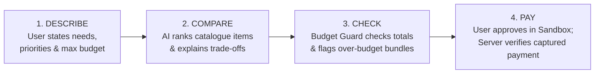

# PayPilot AI 2.0

> **Budget-Aware AI Shopping Assistant with Verified PayPal Sandbox Checkout**
> Built for the **PayPal AI Hackathon**

[](LICENSE)
[](tests/)
[](https://developer.paypal.com/)
[](#accuracy-and-safety-checklist)

---

## 📌 Executive Summary

**PayPilot AI 2.0** connects conversational AI product discovery with **deterministic budget guardrails** and **genuine server-verified PayPal Sandbox payments**.

Users state complex multi-item needs and hard spending ceilings. PayPilot's AI balances competing trade-offs (e.g. reliability vs price vs delivery speed), while an independent **Budget Guard** engine calculates known catalogue prices, flags overages, suggests viable substitutions, and securely guides the buyer through a verified PayPal Sandbox payment flow.

> **The Product Promise**: AI interprets natural-language requests and explains qualitative choices; deterministic code calculates totals and limits; the user reviews and confirms purchases. We never claim access to unauthorized bank data or PayPal capabilities that have not been verified end-to-end.

---

## 🧭 Core User Journey



1. **Describe**: User submits natural-language intent (e.g. college dorm essentials under $150 or urgent laptop replacement).
2. **Compare**: AI compares items from a controlled catalogue across price, reliability scores, and specifications, clearly detailing compromises.
3. **Check**: **Budget Guard** calculates deterministic totals using exact catalogue figures. If a basket exceeds the limit, it alerts the user and suggests alternatives instead of masking the shortfall.
4. **Pay**: The user approves the purchase in PayPal Sandbox. The backend server verifies that the order is captured with `status: COMPLETED` before confirming the purchase.

---

## 👥 Five-Member Team Work Division

All team members collaborate in this unified repository with explicitly defined ownership:

| Member | Previous / Base Role | Updated Responsibilities | Hackathon Focus |
| :--- | :--- | :--- | :--- |
| **Meenal** | Frontend/dashboard and accessibility | Frontend/dashboard, product cards, comparison views, accessibility controls, and checkout screens; connects UI to backend APIs and renders multi-item bundle totals. | Clear ownership of the full shopping UI and bundle comparison. |
| **Jaskaran** | Flask backend/database, records, bill reminders | Flask backend, catalogue, trusted product prices, product/bill APIs, and Budget Guard calculations; calculates bundle totals and flags over-budget options using known values. | Priority shifts to catalogue + Budget Guard; reminders are non-blocking. |
| **Shubhneet** | AI chatbot, voice commands, notification filter | AI intent parsing, product ranking, recommendations, and explanations; handles multi-constraint prompts and trade-offs across several items. | Multi-item reasoning is core; voice/filter staged later. |
| **Suryansh** | PayPal integration and security | PayPal Sandbox create → buyer approval → capture → server-side verification; handles cancellation/errors and coordinates end-to-end integration. | Payment verification and integration coordination are explicit deliverables. |
| **Sehaj** *(This Module)* | Product data, comparison/charts, testing | Product/sample price data and history labels; tests bundle, emergency-expense, and checkout scenarios; owns README, open-source licence, setup notes, and demo readiness. | Testing, documentation/licensing, and demo readiness are explicit deliverables. |

---

## 🚀 Key Features (Original + 3 New Capabilities)

### Three New Capabilities (2.0 Additions)
* **10 • Multi-Item Budget Optimizer (Core MVP)**: Solves multi-item shopping constraints against one unified budget (e.g. desk lamp + portable steamer + ANC earbuds $\le$ $150). Balances compromises and suggests alternatives when limits are breached.
* **08 • Emergency Expense & Medical Bill Navigator**: Assists users during sudden expenses (e.g. broken work laptop 48 hours before deadline) by ranking urgent replacements by delivery speed, warranty terms, and net cost without giving medical/financial advice.
* **09 • Autonomous Group Travel & Event Co-Pilot**: Group budget estimation and fair share breakdown for events (staged for later expansion).

### Seven Retained Capabilities
* **01 • Adaptive Universal Accessibility**: High-contrast modes, scalable typography, keyboard focus navigation, and text-to-speech friendliness.
* **02 • Hands-Free Voice Commands**: Voice input for shopping requests with mandatory visual confirmation before checkout.
* **03 • Proactive Financial Health Monitoring**: Tracks upcoming bills due within 7 days and integrates them into Budget Guard's immediate outlay calculation.
* **04 • Secure Biometric & Passwordless Payments**: Passkey readiness architecture without confusing login with transactional authorization.
* **05 • AI Budget-Conscious Shopping Chatbot**: Multi-turn preference exploration with explicit trade-off explanations.
* **06 • PayPal Honey Price Trend & History Engine**: 90-day price trend visualizations with deal verdicts, explicitly labelled as simulated datasets.
* **07 • Zero-Spam Financial Smart Filter**: Classifies transactional vs suspicious notifications.

---

## 🌟 The Jaw-Dropping Demo Scenario

### Prompt
> *"I’m a college student moving into an unfurnished dorm with a strict $150 total budget. I need a desk lamp, a portable steamer, and noise-cancelling study buds. Prioritize reliability and explain compromises."*

### What Happens
1. **Selection & Reasoning**:
   - **LuminaFlex Clamp LED Lamp** ($29.99, Reliability: 9.2/10) — Saves desk space with durable metal clamp.
   - **SteamGlide Travel Garment Steamer** ($26.50, Reliability: 8.8/10) — Fast 25s heat-up, folds flat.
   - **SoundPulse Neo Hybrid ANC Earbuds** ($54.99, Reliability: 8.9/10) — 35dB noise cancellation for library study.
2. **Budget Guard Verification**:
   $$\$29.99 + \$26.50 + \$54.99 = \$111.48 \quad (\text{Headroom: } +\$38.52)$$
   Status: **`APPROVED BY BUDGET GUARD`** (Average Reliability: **`8.97 / 10`**).
3. **Compromises Explained**:
   - Lamp requires a table lip to mount (cannot stand freely).
   - Steamer reservoir (120ml) requires refills after 2–3 shirts.
   - Studio Pro Earbuds ($95.00) were rejected because they would push the basket to $166.99 (exceeding budget).
4. **PayPal Checkout**:
   - Flows smoothly into PayPal Sandbox order creation and server-verified capture.

---

## 🛡️ Accuracy and Safety Checklist

PayPilot AI 2.0 strictly enforces the following hackathon compliance rules:

* [x] **No False Pay in 4 Claims**: PayPal Pay in 4 is never represented as universally guaranteed. All references carry clear eligibility disclaimers (*"subject to eligibility and credit approval"*), and the full purchase total is always displayed.
* [x] **Installments $\ne$ Affordability**: A small installment amount is never treated as proof of affordability. Full purchase price, taxes, and shipping are always totaled.
* [x] **Verified Payment Truth**: Order creation (`CREATED`) or opening the sandbox approval window (`APPROVED`) is **never** treated as proof of payment. The backend requires verified capture confirmation (`status: COMPLETED`) from PayPal.
* [x] **Transparent Data Provenance**: Every item in `data/products.json`, `data/price_history.json`, and `data/sample_bills.json` contains a `data_source` tag (`simulated`, `sourced`, or `manually_entered`) and a clear disclaimer.
* [x] **Credential Isolation**: Secrets (`PAYPAL_CLIENT_SECRET`, `.env`) are kept strictly on the backend server and never committed to version control.

---

## 📁 Repository Structure

```text
/Paypal
├── README.md                          # Master documentation & project guide (Owned by Sehaj)
├── LICENSE                            # MIT Open-Source License (Owned by Sehaj)
├── SETUP.md                           # Comprehensive environment & developer notes (Owned by Sehaj)
├── DEMO.md                            # Hackathon presentation & 3-minute pitch script (Owned by Sehaj)
├── .env.example                       # Safe environment variables template
├── .gitignore                         # Git exclusion rules
├── requirements.txt                   # Backend & testing dependencies
├── data/                              # Curated datasets with provenance labels (Owned by Sehaj)
│   ├── products.json                  # Catalogue items across categories with reliability scores & trade-offs
│   ├── price_history.json             # 90-day price trends inspired by PayPal Honey
│   ├── sample_bills.json              # 7-day upcoming bill fixtures for proactive monitoring
│   ├── comparison_matrix.json         # Attribute matrix & bundle evaluations
│   └── demo_scenarios.json            # Hackathon demo fixtures & PayPal payloads
├── utils/                             # Core shared utility modules (Owned by Sehaj / Team)
│   ├── __init__.py
│   ├── data_loader.py                 # Data ingestion with strict provenance verification
│   ├── budget_guard.py                # Deterministic arithmetic, budget limits, & substitutions
│   └── comparison_helper.py           # Trade-off explanation & side-by-side matrices
└── tests/                             # Comprehensive test suite (Owned by Sehaj)
    ├── __init__.py
    ├── test_bundle_scenarios.py       # Multi-item dorm room budget optimizer tests ($150 limit)
    ├── test_emergency_expense_scenarios.py # Urgent replacement & delivery speed tests
    ├── test_checkout_scenarios.py     # PayPal order status, capture verification & security tests
    ├── test_data_integrity.py        # Provenance labels & numeric sanity checks
    ├── test_runner.py                 # Python unittest runner
    └── run_tests.ps1                  # Native zero-dependency PowerShell test runner
```

---

## 🧪 Running the Tests

Sehaj's test suite provides **100% automated verification** of all hackathon scenarios and guardrails.

### Native Windows PowerShell (No Setup Required)
```powershell
powershell -ExecutionPolicy Bypass -File .\tests\run_tests.ps1
```

### Python Unittest / Pytest
```bash
python tests/test_runner.py
# or
pytest -v tests/
```

All 8 tests validate:
1. Product catalogue JSON schema and required provenance tags.
2. Dorm scenario optimal bundle arithmetic ($111.48 $\le$ $150.00).
3. Over-budget bundle detection ($181.99 > $150.00) and automatic substitutions.
4. Emergency laptop delivery speed and warranty disclosures.
5. Honey simulated price trends and disclaimers.
6. PayPal `CREATED` status rejection as proof of payment.
7. PayPal `APPROVED` status rejection without server capture.
8. Server-side capture status (`COMPLETED`), amount ($111.48), and currency (`USD`).

---

## 🛠️ API Contracts & Formats

### 1. Evaluate Basket (`POST /api/budget/evaluate`)
**Request**:
```json
{
  "item_ids": ["lamp-01", "steamer-01", "buds-01"],
  "max_budget": 150.00,
  "shipping_cost": 0.00
}
```
**Response**:
```json
{
  "status": "APPROVED",
  "is_under_budget": true,
  "grand_total": 111.48,
  "max_budget": 150.00,
  "variance": 38.52,
  "flags": []
}
```

### 2. PayPal Create Order (`POST /api/paypal/create-order`)
**Response**:
```json
{
  "order_id": "PAYPAL-ORDER-DORM-789123",
  "status": "CREATED",
  "approval_url": "https://www.sandbox.paypal.com/checkoutnow?token=PAYPAL-ORDER-DORM-789123"
}
```

### 3. PayPal Capture Order (`POST /api/paypal/capture-order`)
**Request**:
```json
{
  "order_id": "PAYPAL-ORDER-DORM-789123"
}
```
**Response**:
```json
{
  "status": "COMPLETED",
  "capture_id": "CAPTURE-DORM-445566",
  "verified_amount": "111.48",
  "currency": "USD",
  "payment_verified": true
}
```

---

## 📄 License

This project is licensed under the [MIT License](LICENSE) — see the [LICENSE](LICENSE) file for details.
